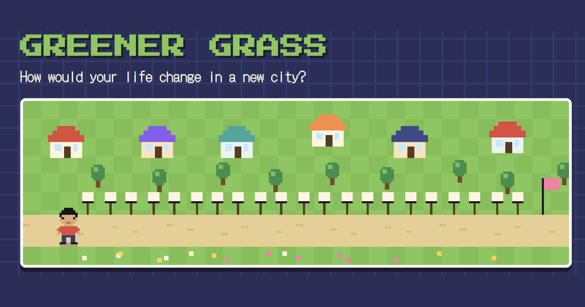

# Greener Grass

**How would your life change in a different city?**

Greener Grass is a pixel-art game that compares 66 US cities for you. Answer about 20 quick questions about your pay, household, how you get around and what you like. You then get a ranked list of the cities that fit you best, with a cost of living receipt that shows how much money you'd have left over in each one.

**Play it:** https://j23y.github.io/greener-grass/

## What you get

- **Top 25 cities for you**, each with a score out of 100, the money you'd have left over each year and how that compares with where you live now.
- **A city report card** comparing any city you tap with where you live now, with grades, factor health bars and Jinxy's hunch.
- **A neighborhood report** with rings for Walk Score, transit and who lives there, plus density, rent and nearby places.
- **A cost of living receipt** for your current city and any city you tap. It covers taxes, rent, transportation, groceries, health, eating out, moving costs and retirement savings. You can edit the lines for your current city, and the same change carries over to every other city.
- **Why a city scored the way it did**: neighborhood fit, safety, parks and nearby nature, weather, walkability, restaurants and culture, schools, your industry, city size, diversity and politics.
- **Your answers**, which you can edit in place to see how the rankings change.

## The cities

The 48 largest US cities, St. Louis and Tallahassee, plus 16 well-known smaller cities: Tampa, Orlando, New Orleans, Pittsburgh, Cincinnati, Cleveland, Salt Lake City, Honolulu, Richmond, Buffalo, Providence, Birmingham, Madison, Boise, Charleston and Durham.

Each city is its official city limits, not its metro area.

## How it works

- **Your neighborhood**: rent, density, commuting, Walk Score and nearby businesses are measured in the census tracts where people your age and income live most.
- **Your money**: 2026 federal, state and city income taxes, each state's sales tax, local prices, and car costs if you drive. Retirement savings go into a 401(k) and then an IRA, up to the 2026 limits.
- **Your score**: each measure ranks a city against the others, and your answers decide how much each one counts.

The full methodology and notes on known gaps are under **Notes** at the end of the game.

## Sources

Main sources include the Census Bureau (ACS, PUMS, County Business Patterns), BEA Regional Price Parities, BLS QCEW, the Tax Foundation, the IRS, the FBI (via Wikipedia and OpenCrime), Trust for Public Land ParkScore and ParkServe, USGS PAD-US, Natural Earth, Walk Score, the Stanford Education Data Archive, HCCI, AAA, Insurance.com, the James Beard Foundation, SMU DataArts and 2024 county election results. The game's Notes list every source with links.

## Caveats

This is for fun. Many numbers are estimates, and a few are the creator's own judgment calls. Treat the results as a conversation starter, not financial advice.

## About

The whole game is a single `index.html` file with no build step or dependencies, beyond Google Fonts and a GoatCounter visit counter.

Made by [joey jung](https://linkedin.com/in/joeyjung), built with Claude.
